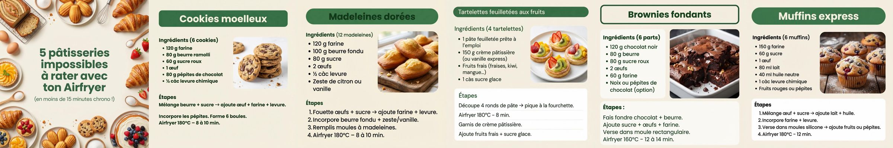
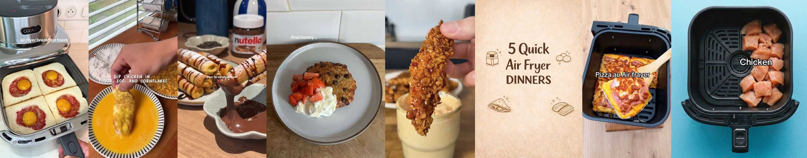

# Healthy Fry — Analyse TikTok & plan d'automatisation

_Données scrapées le 04/11/2026 via Apify (`clockworks/tiktok-scraper`). Fichiers bruts dans `data/`._

## 1. Ce qui marche sur @healthyfry (51 posts, 10,6k abonnés, 42,8k likes)

| Format | Nb | Vues médianes |
|---|---|---|
| **Carrousel (photos)** | 43 | **10 800** |
| Vidéo | 8 | 3 690 |

**Les carrousels font ~3x plus de vues que les vidéos.** Les 4 meilleurs posts sont tous des carrousels :

| Vues | Saves | Post |
|---|---|---|
| **997 200** | 41 542 | 5 pâtisseries impossibles à rater (cookies, madeleines, tartelettes, brownies, muffins) |
| 354 500 | 7 186 | Recettes de Noël à l'Airfryer + CTA e-book |
| 211 400 | 6 490 | Le cookie le plus fondant en 8 min |
| 63 500 | 1 670 | 3 repas healthy impossibles à rater |

Le **sucré / gourmand** (cookies, desserts) fait exploser les compteurs, beaucoup plus que le « healthy » pur.
Le taux de save est énorme (41k saves sur 997k vues = 4 %) : l'audience veut **garder la recette**.

⚠️ **Dernier post : 25/01/2026, donc le compte est inactif depuis ~10 mois.** Il faut relancer avec du volume pour que l'algo réactive le compte.

### DA (direction artistique) actuelle

- Fond **crème / beige** (~`#F4EFE4`), titres **vert forêt** (~`#2E5E3A`), police sans-serif ronde et grasse (type Poppins/Nunito)
- Titres dans des **pastilles vertes arrondies**
- Slide 1 = gros titre accrocheur (« 5 pâtisseries impossibles à rater… ») sur un fond de plats en couronne
- 1 slide = 1 recette : ingrédients en liste + photo du plat + étapes numérotées + temps et température Airfryer
- Dernière slide = CTA (« Enregistre ce post », e-book en bio)
- Images générées par IA, format 1:1 (1024²) ou 9:16 (1180×2096)

## 2. Comptes d'inspiration (tous faceless, sans visage)

| Compte | Abonnés | Meilleur post | Format à copier |
|---|---|---|---|
| [@easyairfryerrecip](https://www.tiktok.com/@easyairfryerrecip/video/7675032524103421217) | 255k | **17M** | **Vidéo de 61 s**, plan fixe sur le panier ouvert, mains seulement, petit texte blanc |
| [@cleanwithcha](https://www.tiktok.com/@cleanwithcha/video/7608989732877372694) (FR) | 110k | 12,3M | « Dessert express airfryer 8-10 min à 180° », mains + Nutella |
| [@martincuisto](https://www.tiktok.com/@martincuisto/video/7588954051530738966) (FR) | 481k | 7,6M | Tenders/butternut, hook « T'as eu un AirFryer à Noël ? », mains seulement |
| [@hufitlife](https://www.tiktok.com/@hufitlife/video/7507729329099427103) | 55k | 15,7M | Tenders healthy, texte à l'écran, recette en légende |
| [@zoe.runlift](https://www.tiktok.com/@zoe.runlift/video/7440433893410442529) | 26k | 11,2M | **Carrousel** cookie protéiné du petit-déj |
| [@airfrayer1217](https://www.tiktok.com/@airfrayer1217/video/7664237571165179168) (FR) | 19k | 4,2M | **Carrousel** photo réelle dans le panier (pizza pain de mie) |
| [@wildcanuk](https://www.tiktok.com/@wildcanuk/video/7614323266290830612) | 70k | 5M | **Carrousel** illustré « 5 Quick Air Fryer Dinners », très proche de votre DA |
| [@fitmealclub](https://www.tiktok.com/@fitmealclub/video/7642334377308982550) / @fithealthfoodie | – | 2,6M | Carrousel avec **macros** (kcal / protéines) |

**Points communs des posts à plusieurs millions de vues :**
1. Aucun visage, juste des **mains** et le **panier de l'airfryer en gros plan**
2. Hook visuel dès la 1re seconde (fromage qui coule, croûte qui craque, chocolat fondu)
3. Promesse chiffrée : « 8 min », « 3 ingrédients », « 150 kcal », « 25 g de protéines »
4. Recette complète en légende pour faire **sauvegarder**
5. Sujets : cookies/desserts express, tenders/nuggets healthy, pommes de terre/frites, petit-déj protéiné

## 3. Point important sur la monétisation (Creator Rewards)

- Seules les **vidéos de plus d'1 min** rapportent. **Les carrousels ne sont pas rémunérés**, mais ils font grossir le compte.
- TikTok exige du contenu **original**. Les vidéos 100 % IA, les reposts et les simples diaporamas sont souvent jugés « non originaux » et ne sont pas payés.
- Donc **pour gagner de l'argent, il faut de vraies images filmées** (vos mains + votre airfryer). Ça ne demande aucun visage et ça coûte 0 €.

## 4. Stratégie recommandée : système hybride à petit budget

| Pilier | Rôle | Fréquence | Production |
|---|---|---|---|
| **Vidéo 60-75 s** « mains + panier » | 💰 Monétisation | 4-5 / semaine | Filmé au téléphone en batch, monté automatiquement |
| **Carrousel DA Healthy Fry** | 📈 Croissance + saves + e-book | 1 / jour | 100 % automatisé (template + images) |

### Pipeline vidéo (~1 h de tournage par semaine)
1. **Batch cooking filmé** : 4-5 recettes par session, téléphone sur trépied au-dessus du plan de travail (vue du dessus + plan du panier ouvert). On filme les rushes, rien d'autre.
2. **Script + voix off** : le script est généré par Claude ; la voix off FR est faite avec ElevenLabs (déjà connecté ici, environ 5 $/mois en plan Starter), ou on fait sans voix avec juste du texte et un son tendance.
3. **Montage automatique** : un template HyperFrames/ffmpeg local qui coupe les rushes, ajoute les titres dans la DA (pastilles vertes, fond crème) et les étapes à l'écran, puis sort un MP4 de 9:16 et d'au moins 61 s.
4. **Programmation** : avec le planificateur natif de TikTok (gratuit) ou avec Zernio (déjà connecté).

### Pipeline carrousel (0 tournage)
1. Une liste de recettes en JSON (titre, ingrédients, étapes, temps et température, macros)
2. Un template HTML aux couleurs Healthy Fry, transformé en PNG 1080×1350 par un script
3. Les images de plats : vos photos des batchs vidéo (plus authentique), ou bien des images IA comme actuellement

### Formats à tester en priorité (repris des posts qui ont fait plusieurs millions de vues)
1. « Le cookie protéiné le plus fondant en 8 min » (vidéo de 61 s + carrousel)
2. « Tenders croustillants sans friture, 25 g de protéines »
3. « 5 desserts impossibles à rater à l'Airfryer » (suite du post à 997k)
4. « Frites/potatoes à moins de 150 kcal »
5. « T'as un Airfryer ? Teste ça ce soir » : série de 3 dîners en 15 min

## 5. Budget mensuel estimé

| Poste | Coût |
|---|---|
| Tournage (téléphone, mains) | 0 € |
| Montage auto (HyperFrames local, ffmpeg) | 0 € |
| Voix off ElevenLabs (facultative) | ~5 $ |
| Images IA pour les carrousels (facultatif) | ~0-10 $ |
| Veille Apify (1 scraping par mois) | ~1 $ |
| **Total** | **~5-15 $ / mois** |
